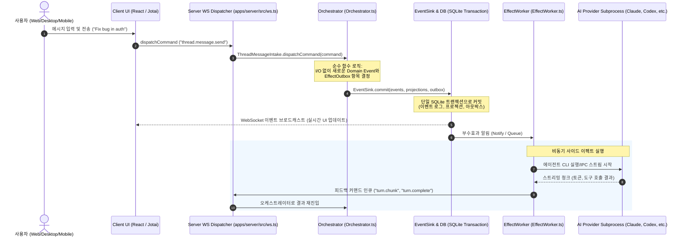

# T3 Code 프로젝트 아키텍처 및 상세 개발 가이드

> **T3 Code**는 로컬 및 원격 환경에서 다양한 AI 코딩 에이전트(Codex, Claude Code, Cursor, OpenCode, Antigravity, Grok 등)를 통합 제어할 수 있는 오픈소스 "BYO-Subscription(사용자 구독 기반)" GUI/제어 평면(Agent Harness Control Surface)입니다.

---

## 1. 프로젝트 개요 및 핵심 기능

### 1.1 프로젝트 철학 및 목적
- **Bring-Your-Own-Subscription**: 별도의 중간 구독 요금 없이 사용자가 기존에 보유한 AI CLI 구독(Claude Pro/Team, OpenAI ChatGPT/Codex, Cursor 등)을 그대로 활용합니다.
- **Remote-Ready Architecture**: 사용자의 워크스페이스가 있는 머신(로컬 PC, 클라우드 VM, 원격 서버)에서 에이전트 프로세스가 실행되며, Web/Desktop/Mobile 클라이언트는 가벼운 상태 동기화 및 제어 UI 역할만 담당합니다.
- **Event-Sourced & Pure Orchestration**: 에이전트 실행 및 턴(turn) 관리가 Effect 기반의 이벤트 소싱 패턴으로 분리되어 있어, 네트워크 단절이나 클라이언트 재접속 시에도 안전하고 멱등성(idempotent) 있는 복원이 가능합니다.

### 1.2 주요 기능
1. **멀티 프로바이더(Multi-Provider) 통합 지원**
   - Claude Code (`claude auth login`)
   - Codex CLI (`codex login`)
   - Cursor CLI (`agent login`)
   - OpenCode (`opencode auth login`)
   - Google Antigravity (Google 계정 연동 및 설정 내 설치)
   - Grok Build, fx, ACP(Agent Client Protocol) 호환 에이전트 등
2. **다중 서피스(Multi-Surface) 클라이언트**
   - **Web App**: 로컬 브라우저 서빙 및 `app.t3.codes` 원격 접속 지원.
   - **Desktop App**: Electron 기반(macOS, Windows, Linux)으로 서버 프로세스를 자체 번들링하여 원클릭 실행 지원.
   - **Mobile App**: React Native (Expo) 기반의 iOS/Android 앱으로 이동 중에도 원격으로 프롬프트 전달 및 모니터링 가능.
3. **히든 Git 레프 기반 체크포인팅(Checkpoints)**
   - 에이전트가 코드를 변경할 때마다 Git 커밋 내역을 오염시키지 않고 숨김 ref(`refs/t3/...`)를 통해 코드 상태를 스냅샷으로 보존하며, 언제든 이전 상태로 롤백 및 diff 검토가 가능합니다.
4. **T3 Connect & 원격 터널링**
   - 자체 릴레이(`relay.t3.codes`) 및 Tailscale을 통한 간편한 원격 페어링/터널링 지원.
5. **통합 터미널 및 인앱 브라우저 미리보기**
   - 가상 PTY 터미널 세션, 프로젝트 포트 자동 감지 및 웹뷰 프리뷰 기능 내장.

---

## 2. 프로젝트 모노레포 구조

T3 Code는 `pnpm` 기반의 모노레포로 구성되어 있습니다.

```
t3code/
├── apps/
│   ├── server/             # 핵심 백엔드: WebSocket RPC, Effect 기반 오케스트레이션, 프로바이더 제어
│   ├── web/                # React 19 + Vite 기반 Web UI (데스크톱 Electron 렌더러로도 재사용)
│   ├── desktop/            # Electron 메인 프로세스, OS 트레이 및 로컬 서버 라이프사이클 관리
│   ├── mobile/             # React Native (Expo) 기반 모바일 앱 (iOS/Android)
│   └── marketing/          # 공식 랜딩 웹사이트 (t3.codes)
├── packages/
│   ├── contracts/          # 클라이언트-서버 간 Effect/Schema 기반 RPC/이벤트 공통 타입 계약
│   ├── client-runtime/     # Web/Mobile/Desktop 공통 연결/동기화 런타임 및 상태 관리
│   ├── shared/             # 유틸리티 (Net, HostProcess, DrainableWorker 등)
│   ├── provider-core/      # 에이전트 프로바이더 공통 추상화 및 세션 인터페이스
│   ├── provider-acp/       # Agent Client Protocol(ACP) 기반 구현체
│   ├── provider-*/         # opencode, cursor, grok, kiro, pi 등 프로바이더별 어댑터
│   └── source-control-*/   # GitHub, GitLab, Bitbucket 등 형상 관리 연동 패키지
├── docs/                   # 아키텍처 및 내부 구현 문서
└── scripts/                # 개발 환경 실행 및 빌드/패키징 스크립트
```

---

## 3. 설치 및 개발 환경 실행 가이드

### 3.1 사전 요구사항
- **Node.js**: `22.16` 이상 (권장: `26.x`, `package.json`의 engines 참조)
- **패키지 매니저**: `pnpm` (10.x / 12.x) 또는 프로젝트 전용 래퍼 도구 `vp` (Vite+ 도구체인)
- **Rust / Cargo** (선택 사항: 네이티브 리소스 모니터 빌드 시 필요)

### 3.2 의존성 설치
```bash
# pnpm으로 설치
pnpm install

# 또는 vite-plus(vp) 사용 시
vp i
```

### 3.3 실행 명령어

| 실행 대상 | 명령어 | 설명 |
| :--- | :--- | :--- |
| **Server + Web (추천)** | `pnpm run dev` 또는 `vp run dev` | 서버(API/WS)와 Vite Web UI를 동시에 실행하고 포트 매핑 |
| **원격 공유 모드** | `pnpm run dev:share` | Tailnet 등을 통해 페어링 가능한 URL 발급 및 실행 |
| **Server 전용** | `pnpm run dev:server` | 서버 백엔드 프로세스만 단독 실행 |
| **Web 전용** | `pnpm run dev:web` | React/Vite 프론트엔드만 단독 실행 |
| **Desktop App** | `pnpm run dev:desktop` | Electron 메인 프로세스 및 UI 번들 실행 |
| **Mobile App (iOS/Android)** | `cd apps/mobile && npx expo start` | Metro 번들러 실행 (dev client 이용) |

> **개발 DB 격리 알림**: `vp run dev` 실행 시 실사용자 DB(`~/.t3/userdata`)를 절대 직접 사용하지 않으며, 작업트리 전용 `.t3/userdata/statev2.sqlite`로 안전하게 복제/격리되어 실행됩니다.

---

## 4. 핵심 실행 아키텍처 및 데이터 흐름

T3 Code의 핵심은 **"클라이언트는 명령(Command)을 내리고, 서버의 Orchestrator는 순수 함수로 이벤트(Event)를 결정하며, EffectWorker가 실제 I/O 부수효과(에이전트 프로세스 스폰, 파일 입출력 등)를 실행한다"**는 점입니다.

### 4.1 시스템 데이터 흐름도 (Mermaid)



---

## 5. 중요 소스 코드 발췌 및 흐름 분석

### 5.1 진입점: CLI 및 서버 구동
- **위치**: [`apps/server/src/bin.ts`](file:///D:/ws-zkllm/t3code/apps/server/src/bin.ts) 및 [`apps/server/src/cli/server.ts`](file:///D:/ws-zkllm/t3code/apps/server/src/cli/server.ts)

Node.js 환경에서 빠른 로딩을 위해 CLI 패스트 패스를 거친 후, 본 서버 런타임을 구동합니다.

```typescript
// apps/server/src/bin.ts 발췌
if (isEntrypoint({ moduleUrl: import.meta.url, entryPath: process.argv[1], runtimeMain: import.meta.main })) {
  const command = process.argv[2];
  if (command === "acp-mcp-bridge" || command === "acp-mcp-call") {
    // 도구 호출 패스트 패스 (초기 지연시간 최소화)
    const { runAcpMcpCliFastPath } = await import("./mcp/AcpMcpStdioBridge.ts");
    await runAcpMcpCliFastPath(command, process.argv.slice(3));
  } else {
    // 기본 CLI 진입
    enableCliCompileCache();
    const { runCli } = await import("./binCli.ts");
    runCli();
  }
}
```

```typescript
// apps/server/src/cli/server.ts 발췌
const runServerCommand = Effect.fn("server.runServerCommand")(function* (flags: CliServerFlags) {
  const { runServer } = yield* Effect.promise(() => import("../server.ts"));
  const config = yield* resolveServerConfig(flags, logLevel, { selectAutomaticPort });
  
  // Effect 계층을 주입하여 서버 실행
  const run = runServer.pipe(Effect.provideService(ServerConfig.ServerConfig, config));
  return yield* run;
});
```

### 5.2 웹소켓 클라이언트 명령 수신부 (Dispatcher)
- **위치**: [`apps/server/src/ws.ts`](file:///D:/ws-zkllm/t3code/apps/server/src/ws.ts)

클라이언트에서 발행한 JSON-RPC 형태의 커맨드가 수신되어 유효성 검증 후 Orchestrator 큐에 추가되는 구간입니다.

```typescript
// apps/server/src/ws.ts 발췌
[ORCHESTRATION_V2_WS_METHODS.dispatchCommand]: (command) =>
  Effect.annotateCurrentSpan({
    "orchestration_v2.command_id": command.commandId,
    "orchestration_v2.command_type": command.type,
    "orchestration_v2.thread_id": command.threadId,
  }).pipe(
    Effect.andThen(
      startup.enqueueCommand(
        ThreadMessageIntake.dispatchCommand(
          ThreadManagementService.withCreationProvenance(command, {
            createdBy: "user",
            creationSource: "web",
          }),
        ).pipe(Effect.provide(intakeContext))
      )
    ),
    Effect.map((result) => ({ sequence: result.sequence })),
    Effect.mapError((cause) => new OrchestrationV2DispatchCommandError({ ... }))
  )
```

### 5.3 오케스트레이터 및 이벤트 소싱/트랜잭션 싱크
- **위치**: [`apps/server/src/orchestration-v2/Orchestrator.ts`](file:///D:/ws-zkllm/t3code/apps/server/src/orchestration-v2/Orchestrator.ts) 및 [`apps/server/src/orchestration-v2/EventSink.ts`](file:///D:/ws-zkllm/t3code/apps/server/src/orchestration-v2/EventSink.ts)

`Orchestrator`는 파일 시스템 I/O나 외부 프로세스 호출 없이, 전달받은 커맨드와 현재 상태를 기반으로 발생할 이벤트 목록과 실행해야 할 사이드 이펙트(아웃박스)를 결정합니다. 이후 `EventSink`가 단일 SQLite 트랜잭션으로 저장합니다.

```typescript
// apps/server/src/orchestration-v2/EventSink.ts 흐름 개념
// 1. 이벤트 로그(Events) 기록
// 2. 프로젝션(Projections: Threads, Runs, Messages 등) 갱신
// 3. 커맨드 영수증(Command Receipt) 저장 (중복 재실행 방지 / 멱등성 확보)
// 4. 아웃박스(Outbox Effects) 큐에 등록
// -> 커밋 후 구독 중인 클라이언트들에게 웹소켓 브로드캐스트
```

### 5.4 부수 효과 워커 (EffectWorker)
- **위치**: [`apps/server/src/orchestration-v2/EffectWorker.ts`](file:///D:/ws-zkllm/t3code/apps/server/src/orchestration-v2/EffectWorker.ts)

DB에 안전하게 커밋된 아웃박스 항목을 꺼내어, 실제 에이전트 CLI 프로세스를 스폰하거나 체크포인트를 저장합니다.

```typescript
// apps/server/src/orchestration-v2/EffectWorker.ts 발췌
// 아웃박스에 등록된 다양한 작업 처리
switch (effect.type) {
  case "provider-turn.start":
    yield* ProviderTurnStartService.startTurn(effect);
    break;
  case "checkpoint.capture":
    yield* CheckpointService.capture(effect);
    break;
  case "provider-turn.interrupt":
    yield* ProviderTurnControlService.interrupt(effect);
    break;
}
```

---

## 6. 코드 수정 시 주요 개발 포인트 가이드

특정 목적에 따라 수정해야 할 핵심 디렉터리와 파일 안내입니다.

```
+-------------------------------------------------------------------------------+
|                             수정 목적별 핵심 디렉터리                          |
+-----------------------------------+-------------------------------------------+
| 1. 새로운 AI 에이전트/프로바이더 추가| packages/provider-*                       |
|                                   | apps/server/src/orchestration-v2/Adapters |
+-----------------------------------+-------------------------------------------+
| 2. 서버-클라이언트 통신 프로토콜 변경 | packages/contracts/src                    |
|                                   | apps/server/src/ws.ts                     |
+-----------------------------------+-------------------------------------------+
| 3. 대화 세션/턴 오케스트레이션 로직  | apps/server/src/orchestration-v2/         |
+-----------------------------------+-------------------------------------------+
| 4. UI 뷰, 프롬프트 입력창, 사이드바  | apps/web/src/components/                  |
|                                   | apps/web/src/state/                       |
+-----------------------------------+-------------------------------------------+
| 5. Git 체크포인트 및 롤백 기능     | apps/server/src/checkpointing/            |
+-----------------------------------+-------------------------------------------+
| 6. Electron 데스크톱 네이티브 기능  | apps/desktop/src/                         |
+-----------------------------------+-------------------------------------------+
```

### 6.1 새로운 AI 프로바이더(Provider)를 추가하거나 기존 어댑터를 수정할 때
1. **패키지 정의**: [`packages/provider-core`](file:///D:/ws-zkllm/t3code/packages/provider-core)의 인터페이스 규격 확인 및 새 프로바이더 패키지([`packages/provider-<name>`](file:///D:/ws-zkllm/t3code/packages)) 작성.
2. **어댑터 등록**: [`apps/server/src/orchestration-v2/ProviderAdapterRegistry.ts`](file:///D:/ws-zkllm/t3code/apps/server/src/orchestration-v2/ProviderAdapterRegistry.ts)에 신규 어댑터 등록.
3. **설치/실행 상태 감지**: [`apps/server/src/provider/`](file:///D:/ws-zkllm/t3code/apps/server/src/provider) 내의 설치 검증 로직 추가.

### 6.2 클라이언트-서버 간 API/RPC 스키마를 수정할 때
1. **계약(Contract) 수정**: [`packages/contracts/src/rpc.ts`](file:///D:/ws-zkllm/t3code/packages/contracts/src/rpc.ts) 및 `orchestrationV2.ts`에 Effect/Schema 정의 추가.
2. **서버 핸들러 구현**: [`apps/server/src/ws.ts`](file:///D:/ws-zkllm/t3code/apps/server/src/ws.ts)의 `ServerWsRpcGroup`에 핸들러 등록.
3. **클라이언트 RPC 훅/명령 추가**: [`packages/client-runtime/src/operations/`](file:///D:/ws-zkllm/t3code/packages/client-runtime/src/operations) 또는 [`apps/web/src/rpc/`](file:///D:/ws-zkllm/t3code/apps/web/src/rpc)에서 호출 로직 연결.

### 6.3 프론트엔드 UI/UX를 수정할 때
1. **프롬프트 입력 에디터**: [`apps/web/src/composer-*.ts`](file:///D:/ws-zkllm/t3code/apps/web/src) 및 `components/composer/` 관련 컴포넌트.
2. **스레드/대화 화면**: [`apps/web/src/routes/`](file:///D:/ws-zkllm/t3code/apps/web/src/routes) 및 `components/chat/` 관련 컴포넌트.
3. **디자인 시스템 가이드**: `apps/web/src/components/ui/`에 있는 컴포넌트는 커스텀 클래스(`className`) 오버라이딩을 지양하고 variant/size 속성을 활용해야 합니다 (AGENTS.md 규칙 참조).

### 6.4 코드 검증 및 테스트 방법
작업 후 변경사항 검증은 다음 명령을 사용합니다:
```bash
# 변경된 파일에 대해서만 포맷, 린트, 타입체크, 유닛 테스트 실행
vp run check:changed

# 특정 테스트 파일 실행
vp test run <파일경로>

# 개별 패키지 타입 체크
vp run typecheck
```
*(주의: 레포지토리 전체 테스트인 `vp check`나 `vp run -r test`는 CI 전용이므로 실행하지 않습니다.)*
